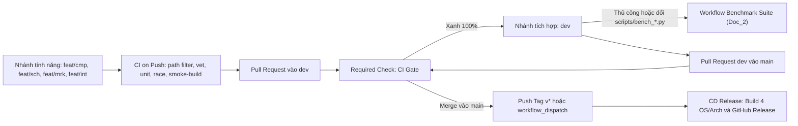

# Quy trình CI/CD trên GitHub cho `Horuzyn/Croc_Team-2`

Tài liệu này mô tả cấu trúc CI/CD đặt tại thư mục gốc `.github/` của repository `https://github.com/Horuzyn/Croc_Team-2.git`.

> **Tại sao đặt workflows ở root `.github/` thay vì `croc-main/.github/`?**  
> GitHub Actions chỉ quét workflow ở thư mục `.github/workflows/` tại **root của Git repository**. Vì mã nguồn Go nằm trong thư mục con `croc-main/` (không có `.git` lồng bên trong), toàn bộ workflow mới ở root sử dụng `working-directory: croc-main` và `go-version-file: croc-main/go.mod` để build/test đúng dự án Go.

---

## 1. Sơ đồ Luồng CI/CD 6 Ngày



---

## 2. Chi tiết 3 Workflows trong `.github/workflows/`

| Workflow | File | Kích hoạt (Trigger) | Nhiệm vụ chính |
| :--- | :--- | :--- | :--- |
| **CI** | [ci.yml](./workflows/ci.yml) | Push vào `main`, `dev`, `feat/**`; PR vào `main`, `dev`; hoặc chạy tay | Phát hiện đường dẫn thay đổi (`go` / `docs`), kiểm tra link trong `docs/`, chạy `go vet`, `go test`, `go test -race`, cross-build static Linux/macOS/Windows và tổng hợp qua job **`CI Gate`**. |
| **Benchmark Suite** | [benchmark.yml](./workflows/benchmark.yml) | Chạy tay (`workflow_dispatch`) hoặc push vào `dev` sửa `scripts/bench_*.py` | Chạy Go micro-benchmarks + các script benchmark Python `Doc_2` (khi đã có trong `croc-main/scripts/`), xuất artifact `croc-benchmark-results` và tóm tắt lên Step Summary. |
| **CD Release** | [cd-release.yml](./workflows/cd-release.yml) | Push tag `v*` hoặc chạy tay (`workflow_dispatch`) | Chạy lại full `go vet`, `go test`, `go test -race`; build 4 binary (`linux-amd64`, `linux-arm64`, `darwin-arm64`, `windows-amd64.exe`) + `SHA256SUMS.txt` và phát hành GitHub Release tự động. |

### Tham khảo đầu việc theo thành viên
- **Nam (`CMP`):** [01_Nam_CMP_Adaptive_Compression.md](../docs/01_Nam_CMP_Adaptive_Compression.md)
- **Sơn (`SCH`):** [02_Son_SCH_Dynamic_Scheduling.md](../docs/02_Son_SCH_Dynamic_Scheduling.md)
- **Long (`MRK`):** [03_Long_MRK_Merkle_Resume.md](../docs/03_Long_MRK_Merkle_Resume.md)
- **Đức (`INT`):** [04_Duc_INT_Integration_Benchmark_Lab.md](../docs/04_Duc_INT_Integration_Benchmark_Lab.md)

---

## 3. Cấu hình Branch Protection trên GitHub (Đức thực hiện 1 lần)

Trên trang repository `https://github.com/Horuzyn/Croc_Team-2` → **Settings → Branches → Add branch protection rule**:
1. Áp dụng cho `main` và `dev`.
2. Bật **Require a pull request before merging** (yêu cầu tối thiểu 1 approval).
3. Bật **Require status checks to pass before merging** và chọn duy nhất check **`CI Gate`**.
   - *Lý do chọn `CI Gate`:* Khi PR chỉ sửa tài liệu `docs/*.md`, các job Go được skip hợp lệ mà `CI Gate` vẫn báo xanh, không làm kẹt PR.
4. Bật **Require conversation resolution before merging**.

---

## 4. Hướng dẫn Đẩy Code & Phát hành Release

### Đẩy cấu hình CI/CD và tài liệu lên `origin/main`
```bash
git add .gitignore .github docs Doc_1.md Doc_2.md croc-main
git commit -m "chore: add 4-member docs and GitHub Actions CI/CD workflows"
git push -u origin main

# Tạo nhánh tích hợp dev cho cả team
git checkout -b dev
git push -u origin dev
```

### Phát hành bản build thử nghiệm (Gate 4 — Code Freeze) hoặc bản chính thức (Gate 6)
```bash
git checkout main
git pull origin main
git tag -a v0.1.0-day4 -m "Day 4 Code Freeze: CMP + SCH + MRK integrated"
git push origin v0.1.0-day4
```
Workflow [cd-release.yml](./workflows/cd-release.yml) sẽ tự động chạy kiểm tra `-race`, đóng gói 4 file binary cùng `SHA256SUMS.txt` và tạo bản Release trên GitHub.
