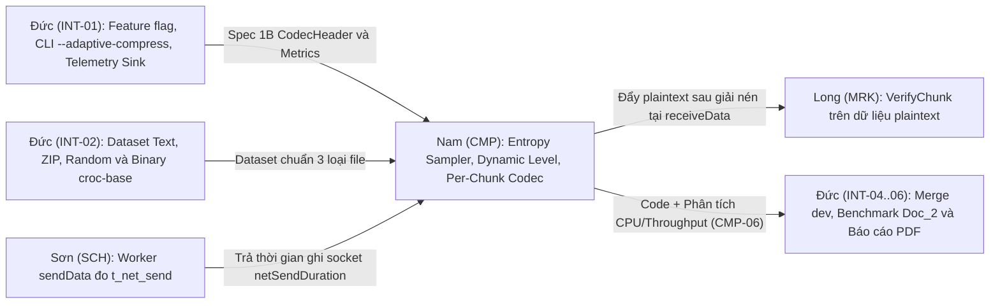

# Đầu việc `CMP` — Nén Thích ứng theo từng Chunk (Nam)

> **Thành viên phụ trách:** **Nam** · **Mã công việc:** `CMP` · **Vai trò:** Core Compression Engineer  
> **Nhánh Git:** `feat/cmp-adaptive` · **Thời lượng:** 6 ngày  
> **Tài liệu gốc:** [Doc_1.md](../Doc_1.md) · [Doc_2.md](../Doc_2.md) · [croc-main/README.md](../croc-main/README.md)  
> **Đầu việc các thành viên khác:** [Sơn (`SCH`)](./02_Son_SCH_Dynamic_Scheduling.md) · [Long (`MRK`)](./03_Long_MRK_Merkle_Resume.md) · [Đức (`INT`)](./04_Duc_INT_Integration_Benchmark_Lab.md)

---

## 1. Mục tiêu Đầu việc & Hiện trạng trong `croc-main`

Trong `croc-main` nguyên bản (v11 / Go 1.27.3), tầng nén hoạt động ở mức **cả file** thay vì từng chunk:
- [croc.go](../croc-main/src/croc/croc.go#L1422-L1478) (`shouldCompressFile`) chỉ lấy mẫu tối đa 256 KiB (chia 5 cửa sổ đối với file lớn) để đặt cờ `IsCompressed` cho toàn bộ file thông qua feature `per-file-compression-v1`.
- [compress.go](../croc-main/src/compress/compress.go) dùng cố định `flate.HuffmanOnly` (level `-2`) với `sync.Pool` (`huffmanWriterPool`, `readerPool`) qua các hàm `CompressTo` và `DecompressTo`.
- Kích thước wire chunk chuẩn là **32 KiB** (`models.TCP_BUFFER_SIZE / 2`, xem [constants.go](../croc-main/src/models/constants.go#L15-L16)) và được kiểm tra biên chặt chẽ bởi `chunkFits` ([chunk_bounds_test.go](../croc-main/src/croc/chunk_bounds_test.go)).

**Nhiệm vụ của Nam (`CMP`):**
1. Thay cơ chế quyết định nén toàn file bằng **lấy mẫu độ ngẫu nhiên (entropy) theo từng chunk 32 KiB**: chunk nén được thì nén, chunk có entropy cao (như video, `.zip`, `/dev/urandom`) thì bỏ qua để tránh tốn CPU vô ích.
2. Tự động **điều chỉnh mức nén `flate`** (`HuffmanOnly`, `BestSpeed`, `Default`) dựa trên nút thắt cổ chai thực tế là **CPU** hay **Mạng**.
3. Bảo toàn kích thước chunk 32 KiB và tương thích ngược hoàn toàn với client `croc` cũ.

**Phạm vi mã nguồn Nam sở hữu:**
- Tạo mới: `croc-main/src/compress/adaptive.go`, `adaptive_test.go`, `controller.go`, `controller_test.go`, `croc-main/src/croc/adaptive_compress_test.go`
- Chỉnh sửa (có phối hợp với Đức): [compress.go](../croc-main/src/compress/compress.go), [compress_test.go](../croc-main/src/compress/compress_test.go), hooks nén/giải nén trong `sendData`/`receiveData` tại [croc.go](../croc-main/src/croc/croc.go#L3746-L4035)

---

## 2. Tóm tắt Giao ước Chung (Shared Contracts — Chốt Ngày 1 cùng Đức)

1. **PAKE Feature Flag:** `adaptive-chunk-compress-v1` (do Đức khai báo ở `INT-01`).
2. **Định dạng Data Frame sau giải mã AEAD:**
   - **Legacy mode (peer không hỗ trợ `adaptive-chunk-compress-v1`):** `[8B Offset LE][Payload]`
   - **Adaptive mode (cả 2 peer hỗ trợ):** `[1B CodecHeader][8B Offset LE][Payload]`
     - `0x00` (`CodecRaw`): Dữ liệu gốc, Receiver bỏ qua bước `DecompressTo`.
     - `0x01` (`CodecFlate`): Dữ liệu nén bằng `flate` (mọi level từ `-2` đến `9`), Receiver giải nén bằng `DecompressTo`.
3. **Bản tin Control Plane liên quan:** Không thêm bản tin riêng; sử dụng `Features []string` trong bản tin PAKE (`TypePAKE` / `TypePAKEConfirm`) và `SenderInfo` ([file_manifest.go](../croc-main/src/croc/file_manifest.go)).
4. **Chuẩn Telemetry JSONL (`--metrics-out <file.jsonl>`):**
   - `{"ts", "event":"chunk_compress", "offset", "entropy", "level", "raw_bytes", "wire_bytes", "cpu_ns"}`

---

## 3. Liên kết Đầu việc giữa Nam (`CMP`) và Team



| Điểm giao kết | Đối tác liên quan | Nội dung phối hợp cụ thể |
| :--- | :--- | :--- |
| **Mở khóa Contract** | **Đức (`INT-01`, `INT-02`)** | Nhận hằng số `adaptive-chunk-compress-v1`, cờ `--adaptive-compress`, interface `telemetry.Sink` và bộ file test (Text, `.zip`, `/dev/urandom`). |
| **Đo nghẽn Mạng vs CPU** | **Sơn (`SCH-04`)** | Tại vòng lặp `sendData`, Sơn cung cấp thời gian gửi socket `netSendDuration` sau mỗi chunk để `AdaptiveController` của Nam xác định nghẽn ở CPU hay Mạng. |
| **Đường ống Receiver** | **Long (`MRK-04`)** | Tại `receiveData`, Nam đọc 1B `CodecHeader` và giải nén (nếu `0x01`) rồi chuyển buffer plaintext cho Long kiểm chứng hash Merkle theo chunk. |
| **Benchmark & Báo cáo** | **Đức (`INT-05`, `INT-06`)** | Đức chạy benchmark tự động xuất CSV/biểu đồ trên 3 loại file; Nam phân tích số liệu và viết phần báo cáo kỹ thuật cho [Doc_2.md](../Doc_2.md). |

---

## 4. Lộ trình 6 Ngày của Nam (`CMP`)

| Ngày | Công việc trọng tâm của Nam | Mốc đồng bộ cả Team (Sync Gate) |
| :---: | :--- | :--- |
| **Ngày 1** | `CMP-01`: Thiết kế Entropy Sampler nhanh & `sync.Pool` đa mức nén theo spec từ Đức (`INT-01`). | **Gate 1 (17:00):** Pull `dev` sau khi Đức merge `feat/int-contracts`, tách nhánh `feat/cmp-adaptive`. |
| **Ngày 2** | `CMP-02` + `CMP-03`: Cài đặt logic bỏ nén theo entropy/tỉ lệ nén và `AdaptiveController` (CPU vs Network). | **Gate 2 (17:30):** Unit test `src/compress` pass 100%, coverage ≥ 85%, pass `-race`. |
| **Ngày 3** | `CMP-04`: Tích hợp 1B `CodecHeader` vào `sendData`/`receiveData` cùng Sơn (`SCH-04`) và Long (`MRK-04`). | **Gate 3 (18:00):** Merge `feat/cmp-adaptive` vào `dev`, chạy truyền nhận thành công qua local relay. |
| **Ngày 4** | `CMP-05`: Tối ưu tái sử dụng buffer (zero-alloc hot path), chạy `-race` & kiểm thử tương thích client cũ. | **Gate 4 (18:00) — CODE FREEZE:** Toàn team freeze code trên nhánh `dev`, mọi test đều xanh. |
| **Ngày 5** | `CMP-06` *(phần 1)*: Thu kết quả benchmark từ Đức (`INT-05`) trên file text, file nén sẵn, file random; phân tích CPU% và MB/s. | **Gate 5 (18:00):** Đủ số liệu + đồ thị CPU/Throughput của 3 loại dữ liệu so với `croc-base`. |
| **Ngày 6** | `CMP-06` *(phần 2)*: Hoàn thiện phần báo cáo kỹ thuật nén thích ứng, review chéo báo cáo của Sơn, Long, Đức và tham gia dry-run demo. | **Gate 6 (16:00) — FINAL DELIVERY:** Đóng gói hoàn chỉnh cùng cả team. |

---

## 5. Danh sách Tasks Chi tiết của Nam (`CMP-01` → `CMP-06`)

- [x] **`CMP-01`: Thiết kế Entropy Sampler & Multi-level `flate` Pool** *(Ngày 1)*
  - **Mô tả kỹ thuật:** Thiết kế hàm lấy mẫu Shannon entropy nhanh trên chunk 32 KiB (lấy mẫu stride 2–4 KiB để chi phí < 5 µs/chunk) và mở rộng [compress.go](../croc-main/src/compress/compress.go) với các `sync.Pool` tách biệt cho `flate.HuffmanOnly` (`-2`), `flate.BestSpeed` (`1`), `flate.DefaultCompression` (`6`).
  - **Phụ thuộc:** Nhận spec 1B `CodecHeader` và feature flag từ **Đức (`INT-01`)**.
  - **Tiêu chí hoàn thành (DoD):** Có tài liệu thiết kế ngắn và micro-benchmark xác nhận chi phí lấy mẫu entropy < 2% thời gian nén chunk.

- [x] **`CMP-02`: Cài đặt Quyết định Bỏ nén theo từng Chunk** *(Ngày 2)*
  - **Mô tả kỹ thuật:** Viết `ShouldSkipCompression` / `AdaptiveCompressChunk` trong `src/compress/adaptive.go`: nếu entropy ước lượng `> 7.5 bits/byte` thì trả về ngay `CodecRaw (0x00)`; nếu thử nén mà `len(compressed) >= 0.96 * len(raw)` thì vẫn gửi `CodecRaw (0x00)` để Receiver không mất CPU giải nén vô ích.
  - **Phụ thuộc:** Độc lập trong `src/compress`.
  - **Tiêu chí hoàn thành (DoD):** Unit test `adaptive_test.go` pass trên 4 loại payload (pure text, JSON/log, `.zip`/`.mp4`, `/dev/urandom`), tỷ lệ bỏ nén trên dữ liệu random > 99%.

- [x] **`CMP-03`: Cài đặt `AdaptiveController` theo Nút thắt CPU vs Mạng** *(Ngày 2)*
  - **Mô tả kỹ thuật:** Trong `src/compress/controller.go`, duy trì EWMA của `t_compress` và `t_net_send`:
    - Nếu CPU nghẽn (`t_compress / (t_compress + t_net_send) > 0.45`): hạ level xuống `BestSpeed` / `HuffmanOnly`, hoặc chỉ nén chunk entropy rất thấp.
    - Nếu Mạng nghẽn (`ratio < 0.15`) và chunk nén tốt: nâng level lên `Default (6)` để giảm lượng byte đẩy lên mạng.
    - Áp dụng hysteresis (ngưỡng trễ) để không đổi level dao động liên tục giữa các chunk.
  - **Phụ thuộc:** Thống nhất chữ ký hàm nhận `netSendDuration` với **Sơn (`SCH-01`)**.
  - **Tiêu chí hoàn thành (DoD):** Unit test `controller_test.go` giả lập đường truyền chậm 1 Mbps và đường truyền nhanh 1 Gbps chuyển mức nén đúng kỳ vọng.

- [ ] **`CMP-04`: Tích hợp Per-Chunk Framing vào `sendData` và `receiveData`** *(Ngày 3)*
  - **Mô tả kỹ thuật:** Quảng bá `adaptive-chunk-compress-v1` trong `pakeFeatures()` ([croc.go](../croc-main/src/croc/croc.go)). Tại `sendData`: nén thích ứng từng chunk, ghi `1B CodecHeader + 8B Offset LE + Payload`, xuất metrics JSONL. Tại `receiveData`: đọc `1B CodecHeader`, giải nén qua `DecompressTo` nếu là `0x01`, bỏ qua nếu `0x00`. Giữ nguyên nhánh legacy khi peer là bản cũ hoặc có `--no-compress`.
  - **Phụ thuộc:** **Đức (`INT-01`)**; phối hợp **Sơn (`SCH-04`)** tại `sendData` và **Long (`MRK-04`)** tại `receiveData`.
  - **Tiêu chí hoàn thành (DoD):** Truyền file hỗn hợp (text ghép nối random) giữa 2 client mới và giữa client mới–cũ đều toàn vẹn SHA-256 100%.

- [ ] **`CMP-05`: Tối ưu Bộ nhớ (Zero-alloc Hot Path) & Kiểm thử Race** *(Ngày 4)*
  - **Mô tả kỹ thuật:** Rà soát tái sử dụng slice (`CompressTo`, `DecompressTo`), đối chiếu `BenchmarkTransferChunkCompression` và `BenchmarkIncompressibleChunkDecision` trong [compress_test.go](../croc-main/src/compress/compress_test.go), chạy `go test -race`.
  - **Phụ thuộc:** Phối hợp **Đức (`INT-04`)** trong đợt kiểm thử tích hợp trên nhánh `dev`.
  - **Tiêu chí hoàn thành (DoD):** Không có Data Race; số lần cấp phát heap/chunk không tăng đáng kể so với baseline.

- [ ] **`CMP-06`: Phân tích Benchmark Nén & Viết Báo cáo Phần 1 (`Doc_2`)** *(Ngày 5–6)*
  - **Mô tả kỹ thuật:** Dùng kết quả benchmark từ **Đức (`INT-05`)** trên 3 tập file (Text, Đã nén `.zip`, Ngẫu nhiên `/dev/urandom`), lập bảng & giải thích độ chênh lệch Throughput (MB/s), CPU (%) và tỷ lệ bỏ qua nén; đóng góp phần viết vào báo cáo cuối và review chéo toàn bộ bài nộp.
  - **Phụ thuộc:** Nhận CSV/đồ thị từ **Đức (`INT-05`)**; bàn giao văn bản cho **Đức (`INT-06`)**.
  - **Tiêu chí hoàn thành (DoD):** Phần báo cáo có đầy đủ bảng đối chứng, biểu đồ và lý giải định lượng rõ ràng.

---

## 6. Lệnh Kiểm thử & Quản trị Rủi ro Riêng cho Nam

```bash
cd croc-main
go test -v -race ./src/compress
go test -v -race -run "Test.*Compress" ./src/croc
go test -bench="Benchmark(TransferChunkCompression|IncompressibleChunkDecision|Adaptive)" -benchmem ./src/compress
```

- **Rủi ro chính:** Chi phí CPU đo entropy + thử nén ở mức `Default (6)` có thể làm chậm đường truyền tốc độ cao (LAN/loopback).
- **Cách xử lý:** Luôn đo trước bằng micro-benchmark với `b.SetBytes` và `b.ReportAllocs()`; đặt trần ngưỡng chuyển lên `Default (6)` chỉ khi `netSendDuration` thực sự vượt xa `compressDuration`.
