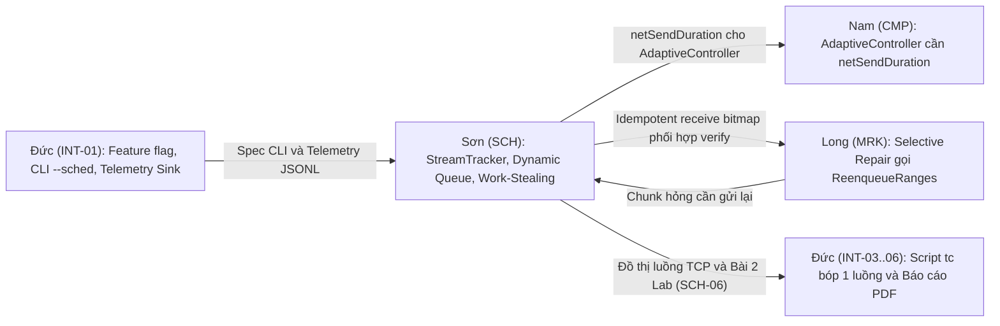

# Đầu việc `SCH` — Lập lịch Chunk Động & Work-Stealing đa luồng TCP (Sơn)

> **Thành viên phụ trách:** **Sơn** · **Mã công việc:** `SCH` · **Vai trò:** Transport & Scheduling Engineer  
> **Nhánh Git:** `feat/sch-workstealing` · **Thời lượng:** 6 ngày  
> **Tài liệu gốc:** [Doc_1.md](../Doc_1.md) · [Doc_2.md](../Doc_2.md) · [croc-main/README.md](../croc-main/README.md)  
> **Đầu việc các thành viên khác:** [Nam (`CMP`)](./01_Nam_CMP_Adaptive_Compression.md) · [Long (`MRK`)](./03_Long_MRK_Merkle_Resume.md) · [Đức (`INT`)](./04_Duc_INT_Integration_Benchmark_Lab.md)

---

## 1. Mục tiêu Đầu việc & Hiện trạng trong `croc-main`

Trong `croc-main` nguyên bản (v11 / Go 1.27.3), luồng đa kết nối TCP hoạt động như sau:
- [chunk_queue.go](../croc-main/src/croc/chunk_queue.go) sử dụng `requestedChunkQueue` cho phép các goroutine worker (mỗi kết nối TCP một worker trong `startSenderUnit`) gọi `claim()` để lấy offset tuần tự 32 KiB.
- Hệ thống **chưa đo tốc độ thực tế từng kết nối TCP**, **không giảm tải** khi một kết nối bị nghẽn/giới hạn băng thông và **không có cơ chế work-stealing** (cướp chunk đang kẹt ở luồng chậm để luồng nhanh xử lý thay). Điều này gây ra hiện tượng nghẽn đuôi (tail latency) làm chậm toàn bộ phiên truyền.
- Xem thêm các bài test hiện có: [chunk_queue_test.go](../croc-main/src/croc/chunk_queue_test.go), [no_multiplexing_test.go](../croc-main/src/croc/no_multiplexing_test.go), [throttle_test.go](../croc-main/src/croc/throttle_test.go).

**Nhiệm vụ của Sơn (`SCH`):**
1. Đo thông lượng (EWMA throughput) và độ trễ ghi socket của từng luồng TCP theo thời gian thực (`StreamTracker`).
2. Lập lịch chunk động: cấp nhiều chunk cho luồng nhanh, áp dụng giảm tải/cooldown cho luồng chậm và triển khai **work-stealing** khi một chunk bị giữ quá lâu.
3. Mở API `ReenqueueRanges(ranges []int64)` an toàn đồng thời để **Long (`MRK`)** đẩy các chunk hỏng quay lại hàng đợi truyền lại chọn lọc.
4. Phụ trách thực nghiệm & giải trình **Bài 2** ([Doc_1.md](../Doc_1.md#L93-L115)) về Giám sát Socket Tầng Giao vận.

**Phạm vi mã nguồn Sơn sở hữu:**
- Tạo mới: `croc-main/src/croc/stream_metrics.go`, `stream_metrics_test.go`, `chunk_scheduler.go`, `chunk_scheduler_test.go`, `dynamic_sched_test.go`
- Chỉnh sửa (có phối hợp với Đức & Nam): [chunk_queue.go](../croc-main/src/croc/chunk_queue.go), [chunk_queue_test.go](../croc-main/src/croc/chunk_queue_test.go), vòng gửi/nhận tại [croc.go](../croc-main/src/croc/croc.go#L3746-L4035)

---

## 2. Tóm tắt Giao ước Chung (Shared Contracts — Chốt Ngày 1 cùng Đức)

1. **PAKE Feature Flag:** `dynamic-chunk-sched-v1` (kích hoạt chế độ nhận idempotent phía Receiver khi có chunk bị work-steal gửi trùng).
2. **CLI Flags (`INT-01`):** `--sched dynamic|static` và cờ phục vụ kiểm thử nội bộ `--debug-throttle-worker <id:rate>`.
3. **API giao tiếp nội bộ với các đầu việc khác:**
   - Cung cấp cho **Nam (`CMP`)**: giá trị `netSendDuration` sau mỗi `dataConn.Send()`.
   - Cung cấp cho **Long (`MRK`)**: hàm `ReenqueueRanges(ranges []int64)` đẩy lại danh sách offset hỏng vào scheduler hiện tại.
4. **Chuẩn Telemetry JSONL (`--metrics-out <file.jsonl>`):**
   - `{"ts", "event":"stream_stat", "worker_id", "local_port", "throughput_bps", "inflight", "stolen_chunks"}`

---

## 3. Liên kết Đầu việc giữa Sơn (`SCH`) và Team



| Điểm giao kết | Đối tác liên quan | Nội dung phối hợp cụ thể |
| :--- | :--- | :--- |
| **Mở khóa Contract** | **Đức (`INT-01`)** | Nhận hằng số `dynamic-chunk-sched-v1`, cờ `--sched`, `--debug-throttle-worker` và interface `telemetry.Sink`. |
| **Phản hồi nghẽn mạng** | **Nam (`CMP-03`, `CMP-04`)** | Trong `sendData`, đo thời gian `dataConn.Send()` và truyền sang bộ điều khiển nén của Nam. |
| **Truyền lại chọn lọc** | **Long (`MRK-05`)** | Khi Long nhận `TypeChunkRepairRequest`, Sender gọi `ReenqueueRanges(ranges)` của Sơn để phát lại đúng các chunk hỏng trên pool đa luồng. |
| **Idempotent Receive** | **Long (`MRK-04`)** | Tại `receiveData`, bitmap chống cộng đúp chunk bị work-steal của Sơn phải đồng bộ với trạng thái kiểm chứng chunk của Long. |
| **Giả lập mạng & Lab** | **Đức (`INT-03`, `INT-05`, `INT-06`)** | Dùng script `tc` của Đức để bóp 1 luồng TCP (port 9010), phân tích đồ thị và nộp phần viết Bài 2 (`Doc_1`) + Benchmark #2 (`Doc_2`) cho Đức. |

---

## 4. Lộ trình 6 Ngày của Sơn (`SCH`)

| Ngày | Công việc trọng tâm của Sơn | Mốc đồng bộ cả Team (Sync Gate) |
| :---: | :--- | :--- |
| **Ngày 1** | `SCH-01`: Phân tích `chunk_queue.go`, chốt thiết kế state machine work-stealing & interface `ReenqueueRanges`. | **Gate 1 (17:00):** Pull `dev` sau khi Đức merge `feat/int-contracts`, tách nhánh `feat/sch-workstealing`. |
| **Ngày 2** | `SCH-02` + `SCH-03`: Cài đặt `StreamTracker` (EWMA) và lõi `adaptiveChunkQueue` có work-stealing trên mock workers. | **Gate 2 (17:30):** Unit test `stream_metrics_test.go` và `chunk_scheduler_test.go` pass 100% với `-race`. |
| **Ngày 3** | `SCH-04`: Nối `adaptiveChunkQueue` vào `startSenderUnit`/`sendData`, cung cấp `netSendDuration` cho Nam và `ReenqueueRanges` cho Long. | **Gate 3 (18:00):** Merge cùng nhánh của Nam vào `dev`, truyền file 800 MB qua 4–8 luồng chạy thông suốt. |
| **Ngày 4** | `SCH-05`: Xử lý idempotent receive (chống đếm trùng khi steal) & chạy test bóp băng thông 1 luồng TCP. | **Gate 4 (18:00) — CODE FREEZE:** Toàn team freeze code trên `dev`, chạy `go test -race` xanh toàn bộ. |
| **Ngày 5** | `SCH-06` *(phần 1)*: Dùng log JSONL từ Đức (`INT-05`) vẽ/phân tích đồ thị thông lượng từng luồng và thực nghiệm chụp `ss -tupn` cho Bài 2 (`Doc_1`). | **Gate 5 (18:00):** Có đủ đồ thị thông lượng từng luồng khi bóp 1 luồng & ảnh chụp socket Bài 2. |
| **Ngày 6** | `SCH-06` *(phần 2)*: Hoàn thiện phần báo cáo Work-Stealing (`Doc_2`) + câu trả lời C2.1–C2.3 (`Doc_1`), review chéo và diễn tập demo. | **Gate 6 (16:00) — FINAL DELIVERY:** Đóng gói hoàn chỉnh cùng cả team. |

---

## 5. Danh sách Tasks Chi tiết của Sơn (`SCH-01` → `SCH-06`)

- [x] **`SCH-01`: Thiết kế Kiến trúc Dynamic Scheduler & Work-Stealing** *(Ngày 1)*
  - **Mô tả kỹ thuật:** Phân tích [chunk_queue.go](../croc-main/src/croc/chunk_queue.go), thiết kế trạng thái cho từng chunk (`Pending`, `InFlight{workerID, startedAt}`, `Done`), định nghĩa interface `ChunkScheduler` gồm `Claim(workerID)`, `Complete(workerID, offset, bytes, dur)`, `Steal(workerID)` và `ReenqueueRanges(ranges []int64)`.
  - **Phụ thuộc:** Nhận spec CLI flag & telemetry từ **Đức (`INT-01`)**; thống nhất chữ ký `ReenqueueRanges` với **Long (`MRK-01`)**.
  - **Tiêu chí hoàn thành (DoD):** Chốt xong thiết kế interface và đảm bảo không giữ lock `mu` khi thực hiện network/disk I/O.

- [x] **`SCH-02`: Cài đặt Bộ đo Thông lượng từng luồng TCP (`StreamTracker`)** *(Ngày 2)*
  - **Mô tả kỹ thuật:** Trong `src/croc/stream_metrics.go`, theo dõi EWMA throughput (`bytes/sec`) và độ trễ trung bình mỗi chunk của từng `workerID`; phân loại luồng `Fast`, `Normal`, `Slow` so với trung vị toàn pool; ghi telemetry JSONL định kỳ (mỗi 200 ms).
  - **Phụ thuộc:** Sử dụng `telemetry.Sink` từ **Đức (`INT-01`)**.
  - **Tiêu chí hoàn thành (DoD):** Unit test `stream_metrics_test.go` phát hiện chính xác một luồng suy giảm tốc độ > 50% trong vòng < 1 giây.

- [x] **`SCH-03`: Cài đặt Hàng đợi Động & Cơ chế Work-Stealing** *(Ngày 2)*
  - **Mô tả kỹ thuật:** Trong `src/croc/chunk_scheduler.go`: luồng `Fast` nhận chunk liên tục không trễ; luồng `Slow` chịu pacing/cooldown giảm tải. Khi hàng đợi `Pending` cạn hoặc một chunk `InFlight` vượt ngưỡng (`elapsed > 3 * median_chunk_time`), luồng `Fast` được phép **steal** chunk đó để gửi song song mà không hủy socket cũ.
  - **Phụ thuộc:** Độc lập với mạng thực qua mock worker tests.
  - **Tiêu chí hoàn thành (DoD):** Unit test `chunk_scheduler_test.go` với 4 worker (1 worker chậm 10×): tổng thời gian giảm rõ rệt, mọi chunk hoàn tất đúng, không deadlock hay livelock.

- [x] **`SCH-04`: Tích hợp Scheduler vào `sendData` & Mở API `ReenqueueRanges`** *(Ngày 3)*
  - **Mô tả kỹ thuật:** Gắn `adaptiveChunkQueue` vào `startSenderUnit` / `sendData` trong [croc.go](../croc-main/src/croc/croc.go#L3938-L4035) khi dùng `--sched dynamic`; chuyển `netSendDuration` cho **Nam (`CMP-03`)**; triển khai `ReenqueueRanges(ranges []int64)` thread-safe cho **Long (`MRK-05`)**.
  - **Phụ thuộc:** Phối hợp **Nam (`CMP-04`)** tại `sendData`; mở đường cho **Long (`MRK-05`)**.
  - **Tiêu chí hoàn thành (DoD):** Truyền file 100–800 MB qua 4–8 luồng TCP ổn định; cờ `--sched static` chạy lại đúng hành vi cũ để benchmark A/B.

- [ ] **`SCH-05`: Xử lý Idempotent Receive & Test Bóp băng thông 1 Luồng** *(Ngày 4)*
  - **Mô tả kỹ thuật:** Vì work-stealing có thể gửi lặp 1 chunk từ 2 luồng khác nhau, bổ sung bitmap/set đánh dấu `offset` đã nhận trong `receiveData` để ghi đè an toàn và **không cộng đúp** `TotalReceived` / `ChunkCount`. Viết `dynamic_sched_test.go` kiểm thử bóp băng thông 1 luồng xuống 512 KB/s.
  - **Phụ thuộc:** Phối hợp **Long (`MRK-04`)** ở luồng nhận và **Đức (`INT-03`)** cho script `tc`.
  - **Tiêu chí hoàn thành (DoD):** Khi 1 luồng bị bóp tốc độ, các luồng nhanh gánh > 85% tổng lượng chunk và loại bỏ hiện tượng chờ luồng chậm ở cuối file.

- [ ] **`SCH-06`: Phân tích Đồ thị Thông lượng & Hoàn thiện Bài 2 Lab (`Doc_1`)** *(Ngày 5–6)*
  - **Mô tả kỹ thuật:** Xử lý dữ liệu benchmark từ **Đức (`INT-05`)** để phân tích đồ thị thông lượng từng luồng TCP theo thời gian (Static vs Dynamic Work-Stealing). Đồng thời thực hiện và trả lời trọn vẹn **Bài 2 (C2.1–C2.3)** của [Doc_1.md](../Doc_1.md#L93-L115): chụp màn hình lệnh `ss -tupn | grep croc` (hoặc `lsof`/`netstat`), đếm socket TCP `ESTABLISHED`, phân tích Multi-streaming TCP vs Single TCP (Băng thông, Head-of-Line Blocking, Bandwidth-Delay Product) và giải thích socket UDP port 9009.
  - **Phụ thuộc:** Nhận đồ thị & kết quả benchmark từ **Đức (`INT-05`)**; nộp bài viết cho **Đức (`INT-06`)**.
  - **Tiêu chí hoàn thành (DoD):** Đủ đồ thị thông lượng từng luồng (`Doc_2`) và trọn vẹn phần Bài 2 kèm ảnh chụp có rõ username/hostname prompt (`Doc_1`).

---

## 6. Lệnh Kiểm thử & Quản trị Rủi ro Riêng cho Sơn

```bash
cd croc-main
go test -v -race -run "Test(RequestedChunkQueue|StreamMetrics|ChunkScheduler|DynamicSched|NoMultiplexing)" ./src/croc
go test -bench="BenchmarkRequestedChunkQueue" -benchmem ./src/croc
```

- **Rủi ro chính:** Data Race / Deadlock giữa `Claim`, `Steal` và `ReenqueueRanges`, hoặc không chạy được `ip netns`/`tc` trên máy không phải Linux native.
- **Cách xử lý:**
  - Tuyệt đối không thực hiện gửi/nhận socket hoặc đọc/ghi file khi đang giữ mutex của `chunk_scheduler`. Nếu thuật toán steal gặp lỗi bất ngờ sát Gate 4, chuyển sang phương án dự phòng **Credit-based Dynamic Assignment + Slow-Stream Cooldown**.
  - Hỗ trợ cờ `--debug-throttle-worker 0:512k` để test bóp riêng 1 luồng ngay trong Go test trên mọi hệ điều hành, song song với script `tc` trên Linux của Đức.
