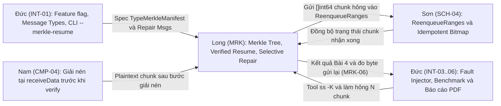

# Đầu việc `MRK` — Cây Merkle, Resume Kiểm chứng & Truyền lại Chọn lọc (Long)

> **Thành viên phụ trách:** **Long** · **Mã công việc:** `MRK` · **Vai trò:** Integrity & Protocol Engineer  
> **Nhánh Git:** `feat/mrk-merkle-resume` · **Thời lượng:** 6 ngày  
> **Tài liệu gốc:** [Doc_1.md](../Doc_1.md) · [Doc_2.md](../Doc_2.md) · [croc-main/README.md](../croc-main/README.md)  
> **Đầu việc các thành viên khác:** [Nam (`CMP`)](./01_Nam_CMP_Adaptive_Compression.md) · [Sơn (`SCH`)](./02_Son_SCH_Dynamic_Scheduling.md) · [Đức (`INT`)](./04_Duc_INT_Integration_Benchmark_Lab.md)

---

## 1. Mục tiêu Đầu việc & Hiện trạng trong `croc-main`

Trong `croc-main` nguyên bản (v11 / Go 1.27.3), cơ chế Resume và toàn vẹn dữ liệu hoạt động như sau:
- Khi file nhận dở dang đã tồn tại trên đĩa, Receiver gọi `utils.MissingChunksFile` ([croc.go](../croc-main/src/croc/croc.go#L3366)) để quét các khối chứa toàn byte `0x00` và lập danh sách `CurrentFileChunkRanges`.
- Việc kiểm tra toàn vẹn thực hiện **một lần ở cuối file** bằng `xxhash` / `imohash` / `md5` ([progressive_hash_test.go](../croc-main/src/croc/progressive_hash_test.go), [receive_hash_test.go](../croc-main/src/croc/receive_hash_test.go)).
- **Hạn chế:** Nếu có một chunk đã ghi trên đĩa bị hỏng dữ liệu (khác `0x00`), quá trình Resume không phát hiện ra cho đến tận khi tải xong toàn bộ file, buộc phải đối chiếu/tải lại toàn bộ file.

**Nhiệm vụ của Long (`MRK`):**
1. Xây dựng cây Merkle mức chunk (32 KiB/lá bằng SHA-256) trong package `src/merkle`.
2. Nâng cấp Resume: đối chiếu hash từng chunk đã có trên đĩa với cây Merkle của Sender để tìm đồng thời **chunk còn thiếu** và **chunk bị hỏng**.
3. Triển khai cơ chế **truyền lại chọn lọc** (`TypeChunkRepairRequest` / `TypeChunkRepairAck`) để chỉ xin lại đúng các chunk hỏng qua `SCH.ReenqueueRanges`.
4. Phụ trách thực nghiệm & giải trình **Bài 4** ([Doc_1.md](../Doc_1.md#L153-L176)) kết hợp kịch bản làm hỏng chunk của [Doc_2.md](../Doc_2.md).

**Phạm vi mã nguồn Long sở hữu:**
- Tạo mới: `croc-main/src/merkle/merkle.go`, `merkle_test.go`, `resume.go`, `resume_test.go`, `croc-main/src/croc/merkle_resume_test.go`
- Chỉnh sửa (có phối hợp với Đức & Sơn): [file_manifest.go](../croc-main/src/croc/file_manifest.go), handlers trong `processMessage` và hook verify tại `receiveData` trong [croc.go](../croc-main/src/croc/croc.go#L3122-L3860)

---

## 2. Tóm tắt Giao ước Chung (Shared Contracts — Chốt Ngày 1 cùng Đức)

1. **PAKE Feature Flag:** `merkle-chunk-resume-v1` (do Đức khai báo ở `INT-01`).
2. **Bản tin Control Plane mới ([message.go](../croc-main/src/message/message.go)):**
   - `TypeMerkleManifest` (`"merkle-manifest"`): Sender gửi `MerkleRoot`, `ChunkSize` (32 KiB), `LeafCount` và danh sách hash lá cho file đang truyền.
   - `TypeChunkRepairRequest` (`"chunk-repair-req"`): Receiver gửi danh sách range các chunk hỏng (`[]int64` đúng định dạng `CurrentFileChunkRanges`).
   - `TypeChunkRepairAck` (`"chunk-repair-ack"`): Sender xác nhận đã đưa các chunk hỏng trở lại bộ lập lịch của Sơn (`SCH`).
3. **Chuẩn Telemetry JSONL (`--metrics-out <file.jsonl>`):**
   - `{"ts", "event":"merkle_verify", "corrupt_chunks", "retransmitted_bytes", "saved_bytes"}`

---

## 3. Liên kết Đầu việc giữa Long (`MRK`) và Team



| Điểm giao kết | Đối tác liên quan | Nội dung phối hợp cụ thể |
| :--- | :--- | :--- |
| **Mở khóa Contract** | **Đức (`INT-01`)** | Nhận hằng số `merkle-chunk-resume-v1`, 3 `message.Type` mới, cờ `--merkle-resume` và interface `telemetry.Sink`. |
| **Đường ống Verify** | **Nam (`CMP-04`)** | Tại `receiveData`, Nam giải nén xong plaintext (theo `CodecHeader`) rồi gọi `VerifyChunk(idx, plaintext)` của Long. |
| **Truyền lại Chọn lọc** | **Sơn (`SCH-04`, `SCH-05`)** | Phía Sender khi nhận `TypeChunkRepairRequest` của Long sẽ gọi `SCH.ReenqueueRanges(ranges)` của Sơn; phía Receiver dùng chung bitmap trạng thái để không đếm nhầm tiến độ. |
| **Fault Injection & Lab** | **Đức (`INT-03`, `INT-05`, `INT-06`)** | Sử dụng script ngắt socket `ss -K` và tool lật byte ngẫu nhiên trên chunk của Đức để thực nghiệm Bài 4 và nộp kết quả cho Đức tổng hợp PDF. |

---

## 4. Lộ trình 6 Ngày của Long (`MRK`)

| Ngày | Công việc trọng tâm của Long | Mốc đồng bộ cả Team (Sync Gate) |
| :---: | :--- | :--- |
| **Ngày 1** | `MRK-01`: Thiết kế cây Merkle 32 KiB/lá SHA-256 & đặc tả bản tin `MerkleManifest` / `ChunkRepair` theo spec từ Đức (`INT-01`). | **Gate 1 (17:00):** Pull `dev` sau khi Đức merge `feat/int-contracts`, tách nhánh `feat/mrk-merkle-resume`. |
| **Ngày 2** | `MRK-02` + `MRK-03`: Xây dựng package `src/merkle` và bộ quét Resume song song `VerifiedMissingChunks`. | **Gate 2 (17:30):** Unit test `merkle_test.go` và `resume_test.go` pass 100% với `-race`. |
| **Ngày 3** | `MRK-04`: Tích hợp `MerkleManifest` vào handshake/manifest và hook `VerifyChunk` vào `receiveData` sau bước của Nam (`CMP-04`). | **Gate 3 (18:00):** Client mới trao đổi được `MerkleManifest`; client cũ tự fallback mượt mà. |
| **Ngày 4** | `MRK-05`: Nối luồng `TypeChunkRepairRequest`/`Ack` vào `SCH.ReenqueueRanges` của Sơn (`SCH-04`) và chạy E2E test làm hỏng chunk. | **Gate 4 (18:00) — CODE FREEZE:** Cả 3 tính năng chạy chung trên nhánh `dev`, pass toàn bộ `-race` và compat tests. |
| **Ngày 5** | `MRK-06` *(phần 1)*: Thực nghiệm Bài 4 trên file 800 MB (cắt mạng ở 50% + làm hỏng 1–5 chunk), chụp log `--debug`, đo lượng byte gửi lại. | **Gate 5 (18:00):** Đủ số liệu đo byte truyền lại + ảnh log resume/repair chuẩn quy cách. |
| **Ngày 6** | `MRK-06` *(phần 2)*: Hoàn thiện câu trả lời C4.1–C4.3 (`Doc_1`) + mục Merkle Resume (`Doc_2`), review chéo toàn team và demo. | **Gate 6 (16:00) — FINAL DELIVERY:** Đóng gói hoàn chỉnh cùng cả team. |

---

## 5. Danh sách Tasks Chi tiết của Long (`MRK-01` → `MRK-06`)

- [ ] **`MRK-01`: Thiết kế Cây Merkle & Giao thức Kiểm chứng Resume** *(Ngày 1)*
  - **Mô tả kỹ thuật:** Chốt kích thước lá **32 KiB** khớp 1-1 với wire chunk (file 800 MB có ~25,600 lá × 32B ≈ 800 KiB RAM). Quy chuẩn domain separation: lá `SHA256(0x00 || chunk)`, nút cha `SHA256(0x01 || left || right)`. Thiết kế payload `MerkleManifest` và state machine cho `TypeChunkRepairRequest`/`Ack`.
  - **Phụ thuộc:** Nhận message types từ **Đức (`INT-01`)**; khớp định dạng `[]int64` cho `ReenqueueRanges` với **Sơn (`SCH-01`)**.
  - **Tiêu chí hoàn thành (DoD):** Tài liệu thiết kế nêu rõ xử lý file 0 byte, file < 32 KiB, file không chia hết cho 32 KiB và giới hạn size control message.

- [ ] **`MRK-02`: Xây dựng Package `src/merkle`** *(Ngày 2)*
  - **Mô tả kỹ thuật:** Triển khai trong `src/merkle/merkle.go`: `BuildTreeFromFile(path, chunkSize)`, `Root()`, `LeafHashes()`, `VerifyChunk(index, data)` và `DiffLeaves(localLeaves, remoteLeaves) -> []int64` (trả về định dạng `ChunkRanges` tương thích `croc`).
  - **Phụ thuộc:** Độc lập hoàn toàn (dùng `crypto/sha256` chuẩn Go).
  - **Tiêu chí hoàn thành (DoD):** Unit test `merkle_test.go` pass mọi edge cases và phát hiện chính xác 1 bit bị lật ở bất kỳ chunk nào.

- [ ] **`MRK-03`: Nâng cấp Bộ quét Resume Kiểm chứng trên Đĩa (`VerifiedMissingChunks`)** *(Ngày 2)*
  - **Mô tả kỹ thuật:** Trong `src/merkle/resume.go`, dùng worker pool (`runtime.NumCPU()`) đọc và băm song song các chunk hiện có trên file tạm, đối chiếu với `remoteLeaves` để trả về `missing ∪ corrupted` dưới dạng `[]int64`.
  - **Phụ thuộc:** Dựa trên `src/merkle/merkle.go`.
  - **Tiêu chí hoàn thành (DoD):** Unit test `resume_test.go` tạo file dở dang 50% và ghi đè rác vào 3 chunk bất kỳ → phát hiện chính xác 3 chunk hỏng + 50% phần thiếu.

- [ ] **`MRK-04`: Tích hợp Merkle vào Handshake, Manifest & Inline Verification** *(Ngày 3)*
  - **Mô tả kỹ thuật:** Quảng bá `merkle-chunk-resume-v1` trong `pakeFeatures()`. Gắn `MerkleRoot` vào `FileInfo` ([file_manifest.go](../croc-main/src/croc/file_manifest.go)), gửi/nhận `TypeMerkleManifest`. Tại `receiveData` (sau bước giải nén của **Nam**), gọi `VerifyChunk(idx, plaintext)`; nếu sai → ghi vào danh sách `corruptChunks`.
  - **Phụ thuộc:** **Đức (`INT-01`)**; móc nối ngay sau bước giải nén của **Nam (`CMP-04`)**.
  - **Tiêu chí hoàn thành (DoD):** Peer mới trao đổi được `MerkleManifest`; peer cũ tự động fallback về cơ chế hash cuối file truyền thống.

- [ ] **`MRK-05`: Cài đặt Luồng Truyền lại Chọn lọc (`TypeChunkRepairRequest`/`Ack`)** *(Ngày 4)*
  - **Mô tả kỹ thuật:** Khi kết thúc lượt nhận chính hoặc ngay khi Resume phát hiện chunk hỏng, Receiver gửi `TypeChunkRepairRequest` chứa các range lỗi; Sender xử lý trong `processMessage`, gọi `SCH.ReenqueueRanges(ranges)` của **Sơn** và phản hồi `TypeChunkRepairAck`. Giới hạn tối đa 3 vòng retry để tránh vòng lặp vô hạn khi lỗi ổ đĩa vật lý; xuất telemetry `merkle_verify`.
  - **Phụ thuộc:** API `ReenqueueRanges` của **Sơn (`SCH-04`)**.
  - **Tiêu chí hoàn thành (DoD):** E2E test `merkle_resume_test.go`: truyền file 10 MB, ngắt giữa chừng, làm hỏng 2 chunk (64 KiB) trên đĩa, resume → chỉ truyền lại phần thiếu + 64 KiB hỏng, SHA-256 cuối khớp 100%.

- [ ] **`MRK-06`: Thực nghiệm Bài 4 (`Doc_1` + `Doc_2`) & Viết Báo cáo Toàn vẹn** *(Ngày 5–6)*
  - **Mô tả kỹ thuật:** Thực hiện kịch bản Bài 4 trên `testfile_800MB.bin`: ngắt kết nối ở ~50% (Ctrl+C hoặc `ss -K`), dùng tool fault-injector làm hỏng 1–5 chunk, resume với `--debug`. Chụp log chứng minh resume offset + sửa đúng chunk hỏng; lập bảng so sánh lượng byte gửi lại (chỉ vài chục KiB) so với truyền lại 800 MB. Trả lời trọn vẹn **Bài 4 (C4.1–C4.3)** của [Doc_1.md](../Doc_1.md#L153-L176) (so sánh TCP Retransmission vs Application Merkle Chunk Resuming).
  - **Phụ thuộc:** Dùng script/fault-injector từ **Đức (`INT-03`)**; nộp bài viết cho **Đức (`INT-06`)**.
  - **Tiêu chí hoàn thành (DoD):** Có ảnh chụp log rõ username/hostname prompt, bảng định lượng byte tiết kiệm được và lời giải sâu sắc toàn bộ Bài 4.

---

## 6. Lệnh Kiểm thử & Quản trị Rủi ro Riêng cho Long

```bash
cd croc-main
go test -v -race ./src/merkle
go test -v -race -run "Test(Merkle|ProgressiveHash|ReceiveHash)" ./src/croc
```

- **Rủi ro chính:** Thời gian băm lại file lớn 800 MB khi Resume hoặc tràn kích thước tin nhắn Control Plane khi file có quá nhiều lá Merkle.
- **Cách xử lý:**
  - Dùng worker pool song song `runtime.NumCPU()` để băm SHA-256 khi quét file trên đĩa (~800 MB SHA-256 trên CPU hiện đại chỉ mất dưới 1 giây) và chỉ lưu mảng hash lá (~800 KiB RAM).
  - Chia nhỏ `TypeMerkleManifest` theo lô (tương tự `TypeFileInfoBatch` trong [file_manifest.go](../croc-main/src/croc/file_manifest.go)) để không vượt quá giới hạn kích thước bản tin trong [message.go](../croc-main/src/message/message.go).
