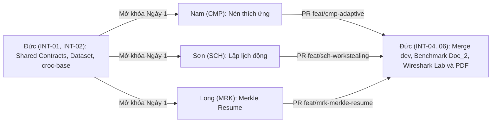

# Đầu việc `INT` — Kiến trúc Chung, Tích hợp, Benchmark & Lab `Doc_1` (Đức)

> **Thành viên phụ trách:** **Đức** *(Lead)* · **Mã công việc:** `INT` · **Vai trò:** Lead Integration, QA & Lab Engineer  
> **Nhánh Git:** `feat/int-contracts` & nhánh tích hợp `dev` · **Thời lượng:** 6 ngày  
> **Tài liệu gốc:** [Doc_1.md](../Doc_1.md) · [Doc_2.md](../Doc_2.md) · [croc-main/README.md](../croc-main/README.md)  
> **Đầu việc các thành viên khác:** [Nam (`CMP`)](./01_Nam_CMP_Adaptive_Compression.md) · [Sơn (`SCH`)](./02_Son_SCH_Dynamic_Scheduling.md) · [Long (`MRK`)](./03_Long_MRK_Merkle_Resume.md)

---

## 1. Mục tiêu Đầu việc & Hiện trạng trong `croc-main`

Đức giữ vai trò **Lead Kỹ thuật & Tích hợp**: thiết lập bộ giao ước dùng chung ngay Ngày 1 để **Nam (`CMP`)**, **Sơn (`SCH`)** và **Long (`MRK`)** phát triển song song không xung đột; xây dựng hạ tầng Benchmark & giả lập mạng tự động; trực tiếp thực hiện Bài 1 & Bài 3 của [Doc_1.md](../Doc_1.md) và biên tập/đóng gói sản phẩm cuối cùng.

Các tài liệu & script nền tảng trong `croc-main` cần tham chiếu:
- [message.go](../croc-main/src/message/message.go), [cli.go](../croc-main/src/cli/cli.go), [Makefile](../croc-main/Makefile)
- [TESTING.md](../croc-main/src/docs/TESTING.md) (quy trình chạy local relay và cắt socket bằng `ss -K`)
- [SMALL_FILE_BUNDLES.md](../croc-main/src/docs/SMALL_FILE_BUNDLES.md) & [SMALL_FILE_BUNDLES_BENCHMARKS.md](../croc-main/src/docs/SMALL_FILE_BUNDLES_BENCHMARKS.md)
- [benchmark-bundles.py](../croc-main/scripts/benchmark-bundles.py) & [bundle_bench_common.py](../croc-main/scripts/bundle_bench_common.py) (mẫu Linux `ip netns` + `tc netem` + đo `/proc/<pid>/net/tcp`)

**Phạm vi mã nguồn & sản phẩm Đức sở hữu:**
- Tạo mới: `croc-main/src/telemetry/metrics.go`, `croc-main/src/croc/integration_upgrade_test.go`, `croc-main/scripts/gen-datasets.sh`, `bench_adaptive_compress.py`, `bench_dynamic_sched.py`, `bench_merkle_resume.py`, `plot_results.py`
- Chỉnh sửa (điều phối chung): [message.go](../croc-main/src/message/message.go), [cli.go](../croc-main/src/cli/cli.go), [Makefile](../croc-main/Makefile), giải quyết merge conflict tại [croc.go](../croc-main/src/croc/croc.go)
- Sản phẩm Lab & Nộp bài: `Captures/lab_croc_lan.pcapng`, `Captures/lab_croc_relay.pcapng`, `BaoCao_ThuHoach.pdf`, `LabNetwork_Nhom<SoNhom>_*.zip`

---

## 2. Giao ước Chung do Đức Chốt & Quản lý (Shared Contracts)

1. **3 PAKE Feature Flags (tương thích ngược với `croc-base`):**
   - `adaptive-chunk-compress-v1` → **Nam (`CMP`)**
   - `dynamic-chunk-sched-v1` → **Sơn (`SCH`)**
   - `merkle-chunk-resume-v1` → **Long (`MRK`)**
2. **CLI Flags chuẩn hóa trong [cli.go](../croc-main/src/cli/cli.go):**
   - `--adaptive-compress` (bật/tắt nén thích ứng)
   - `--sched dynamic|static` (chọn bộ lập lịch)
   - `--merkle-resume` (bật/tắt Merkle resume)
   - `--metrics-out <path.jsonl>` (xuất telemetry)
   - `--debug-throttle-worker <id:rate>` (hỗ trợ test bóp 1 luồng đa nền tảng cho Sơn)
3. **Bản tin Control Plane mới ([message.go](../croc-main/src/message/message.go)):**
   - `TypeMerkleManifest` (`"merkle-manifest"`), `TypeChunkRepairRequest` (`"chunk-repair-req"`), `TypeChunkRepairAck` (`"chunk-repair-ack"`).
4. **Chuẩn Telemetry JSONL (`src/telemetry/metrics.go`):**
   - Thống nhất schema cho 3 sự kiện `chunk_compress` (Nam), `stream_stat` (Sơn), `merkle_verify` (Long).

---

## 3. Liên kết Đầu việc giữa Đức (`INT`) và Team



| Điểm giao kết | Đối tác liên quan | Nội dung phối hợp cụ thể |
| :--- | :--- | :--- |
| **Mở khóa Ngày 1** | **Nam, Sơn, Long** | Merge `feat/int-contracts` vào `dev` trước 17:00 Ngày 1 để cả 3 thành viên tách nhánh và phát triển song song. |
| **Hạ tầng Benchmark** | **Nam, Sơn, Long** | Cung cấp bộ dataset chuẩn (`INT-02`), script `ip netns`/`tc`/`ss -K`/fault-injector (`INT-03`) và nhận lại JSONL đúng chuẩn. |
| **Điều phối Merge** | **Nam → Sơn → Long** | Thứ tự merge bắt buộc vào `dev`: `CMP` trước, `SCH` thứ hai, `MRK` cuối cùng để kiểm soát xung đột tại `croc.go`. |
| **Tổng hợp Báo cáo** | **Nam (`CMP-06`), Sơn (`SCH-06`), Long (`MRK-06`)** | Nhận phần phân tích của 3 thành viên + kết hợp Bài 1 & Bài 3 của Đức để xuất `BaoCao_ThuHoach.pdf` và đóng gói `.zip`. |

---

## 4. Lộ trình Điều phối 6 Ngày của Đức (`INT`)

| Ngày | Công việc trọng tâm của Đức | Mốc đồng bộ cả Team (Sync Gate) |
| :---: | :--- | :--- |
| **Ngày 1** | `INT-01` + `INT-02`: Chốt & code Shared Contracts (`feat/int-contracts`), sinh bộ dataset chuẩn & build `bin/croc-base`. | **Gate 1 (17:00):** Merge `feat/int-contracts` vào `dev`; điều phối Nam, Sơn, Long pull `dev` chạy xanh. |
| **Ngày 2** | `INT-03` *(phần 1)*: Xây dựng `bench_adaptive_compress.py`, `bench_dynamic_sched.py`, `bench_merkle_resume.py` và chạy thử trên `croc-base`. | **Gate 2 (17:30):** Kiểm tra kết quả unit test & coverage ≥ 85% của 3 nhánh lõi. |
| **Ngày 3** | `INT-03` *(phần 2)* + `INT-04` *(giai đoạn 1)*: Hoàn thiện `plot_results.py`, viết khung `integration_upgrade_test.go`, thực hành trước Bài 1–3 trên baseline. | **Gate 3 (18:00):** Hỗ trợ merge nhánh của Nam (`CMP`) và Sơn (`SCH`) vào `dev`. |
| **Ngày 4** | `INT-04` *(giai đoạn 2)*: Merge nhánh của Long (`MRK`), xử lý xung đột `croc.go`, chạy full `go test -race` và ma trận tương thích New↔Base. | **Gate 4 (18:00) — CODE FREEZE:** Đóng băng tính năng trên `dev`, build bản `croc-upgraded` chuẩn. |
| **Ngày 5** | `INT-05`: Chạy chính thức toàn bộ Benchmark (`Doc_2`), gửi CSV/đồ thị cho Nam/Sơn/Long; hoàn thiện Bài 1 & Bài 3 Wireshark `.pcapng`. | **Gate 5 (18:00):** Thu đủ 2 file `.pcapng`, ảnh chụp màn hình rõ prompt và 3 bộ đồ thị Benchmark. |
| **Ngày 6** | `INT-06`: Hợp nhất báo cáo từ Nam, Sơn, Long; kiểm định 100% quy định trừ điểm `Doc_1`; xuất `BaoCao_ThuHoach.pdf`, đóng gói `.zip` & dẫn dắt dry-run demo. | **Gate 6 (16:00) — FINAL DELIVERY:** Nộp bài đúng quy cách và sẵn sàng demo. |

---

## 5. Danh sách Tasks Chi tiết của Đức (`INT-01` → `INT-06`)

- [ ] **`INT-01`: Thiết lập Shared Contracts, CLI Flags & Telemetry Sink** *(Ngày 1)*
  - **Mô tả kỹ thuật:** Khai báo 3 hằng số PAKE feature và 3 `message.Type` mới trong [message.go](../croc-main/src/message/message.go); bổ sung CLI flags vào [cli.go](../croc-main/src/cli/cli.go); viết `src/telemetry/metrics.go` ghi JSONL thread-safe.
  - **Phụ thuộc:** Thống nhất spec cuối cùng với **Nam (`CMP-01`)**, **Sơn (`SCH-01`)**, **Long (`MRK-01`)** đầu ngày 1.
  - **Tiêu chí hoàn thành (DoD):** `dev` build sạch, `go test ./src/cli ./src/message` pass 100%, cả 3 thành viên khác tách nhánh làm việc ngay được.

- [ ] **`INT-02`: Chuẩn bị Môi trường Lab, Dataset Chuẩn & Binary Baseline** *(Ngày 1)*
  - **Mô tả kỹ thuật:** Viết `scripts/gen-datasets.sh` sinh 4 bộ file kiểm thử: `testfile_800MB.bin` (`/dev/urandom` đúng quy định [Doc_1.md](../Doc_1.md#L53-L61)), `dataset_text_200MB.log`, `dataset_compressed_200MB.zip`, `dataset_mixed_200MB.bin` kèm SHA-256 manifest. Build `bin/croc-base` từ commit gốc `croc-main`.
  - **Phụ thuộc:** Độc lập.
  - **Tiêu chí hoàn thành (DoD):** Một lệnh chạy sinh đủ bộ dataset chuẩn và file checksum đối chứng cho toàn team.

- [ ] **`INT-03`: Xây dựng Bộ Script Benchmark & Fault Injection (`Doc_2`)** *(Ngày 2–3)*
  - **Mô tả kỹ thuật:** Tham khảo [benchmark-bundles.py](../croc-main/scripts/benchmark-bundles.py) và [TESTING.md](../croc-main/src/docs/TESTING.md) để viết:
    1. `bench_adaptive_compress.py`: đo MB/s và %CPU trên text, `.zip`, random.
    2. `bench_dynamic_sched.py`: dựng `ip netns` + `tc` bóp băng thông riêng 1 port TCP (vd: 9010) hoặc kích hoạt `--debug-throttle-worker`, ghi nhận JSONL từng luồng.
    3. `bench_merkle_resume.py`: ngắt socket bằng `ss -K`, lật byte ở N chunk ngẫu nhiên trên đĩa, đo lượng byte gửi lại sau resume.
    4. `plot_results.py`: tự động xuất đồ thị PNG so sánh từ CSV/JSONL.
  - **Phụ thuộc:** Khớp schema JSONL với **Nam**, **Sơn**, **Long**.
  - **Tiêu chí hoàn thành (DoD):** Chạy thử nghiệm trơn tru trên `bin/croc-base` và xuất file CSV/PNG mẫu.

- [ ] **`INT-04`: Tích hợp Toàn bộ Nhánh, Kiểm thử E2E & Tương thích ngược** *(Ngày 3–4)*
  - **Mô tả kỹ thuật:** Viết `integration_upgrade_test.go`; điều phối review và merge lần lượt `feat/cmp-adaptive` → `feat/sch-workstealing` → `feat/mrk-merkle-resume` vào `dev`; chạy ma trận tương thích (New↔New, New↔Base, Base↔New) và toàn bộ `go test -race`.
  - **Phụ thuộc:** Hoàn thành `CMP-04`, `SCH-04`, `MRK-05`.
  - **Tiêu chí hoàn thành (DoD):** **Code Freeze cuối Ngày 4** — toàn bộ unit + integration + `-race` pass 100%, không vỡ tương thích ngược.

- [ ] **`INT-05`: Chạy Full Benchmark (`Doc_2`) & Thực nghiệm Lab Bài 1, Bài 3 (`Doc_1`)** *(Ngày 5)*
  - **Mô tả kỹ thuật:**
    1. Chạy chính thức 3 bộ Benchmark so sánh `croc-base` vs `croc-upgraded` (lặp 3 lần lấy trung vị), chuyển số liệu/biểu đồ cho Nam, Sơn, Long phân tích.
    2. Thực hiện **Bài 1 (C1.1–C1.3)**: chạy `--debug` ghi log 4 giai đoạn logic (Signaling, PAKE/SPAKE2, Discovery, Data channel).
    3. Thực hiện **Bài 3 (C3.1–C3.3)**: dùng Wireshark với bộ lọc `tcp.port in {9009..9013} || udp.port == 9009`, chạy `--local --debug` (lưu `Captures/lab_croc_lan.pcapng`) và `--no-local --transport relay --debug` (lưu `Captures/lab_croc_relay.pcapng`), chụp `Follow TCP Stream`, vẽ Sequence Diagram cho 2 kịch bản LAN vs WAN Relay.
  - **Phụ thuộc:** Bản build `croc-upgraded` sau Gate 4.
  - **Tiêu chí hoàn thành (DoD):** Có đủ 2 file `.pcapng` chuẩn xác, ảnh chụp terminal thấy rõ prompt/username và 3 bộ đồ thị Benchmark.

- [ ] **`INT-06`: Tổng hợp Báo cáo PDF, Kiểm định Barem & Đóng gói Nộp bài** *(Ngày 6)*
  - **Mô tả kỹ thuật:** Hợp nhất phần viết từ **Nam (`CMP-06`)**, **Sơn (`SCH-06`)**, **Long (`MRK-06`)** cùng Bài 1 & Bài 3. Kiểm tra chặt chẽ toàn bộ quy định chấm/trừ điểm của [Doc_1.md](../Doc_1.md#L178-L206):
    - Đủ 2 file `Captures/lab_croc_lan.pcapng` và `Captures/lab_croc_relay.pcapng` (không bị trừ 2.0 điểm).
    - Mọi câu C1.1–C4.3 đều có ảnh minh chứng rõ dấu nhắc lệnh prompt (không bị trừ 0.5 điểm/câu).
    - Xuất định dạng **`BaoCao_ThuHoach.pdf`** (tuyệt đối không nộp file Word thô).
    - Đóng gói đúng cấu trúc `.zip` theo quy cách nộp bài và tổ chức dry-run demo 3 tính năng mới.
  - **Phụ thuộc:** Nhận đầy đủ phần đóng góp từ **Nam**, **Sơn**, **Long**.
  - **Tiêu chí hoàn thành (DoD):** File `.zip` mở kiểm tra sạch đẹp, không thiếu minh chứng, demo thực tế chạy mượt mà.

---

## 6. Lệnh Kiểm thử Tổng hợp & Quản trị Rủi ro cho Đức

```bash
cd croc-main
make build
go test ./...
go test -race ./src/croc ./src/compress ./src/merkle ./src/message ./src/receivefs
```

- **Rủi ro chính:**
  1. Xung đột code nặng ở `src/croc/croc.go` khi ghép 3 nhánh.
  2. `croc` v11 mặc định `--transport auto` (Tailcat/WireGuard) có thể làm Wireshark không thấy lưu lượng trên cổng `9009..9013`.
- **Cách xử lý:**
  1. Ép buộc 90% code mới nằm ở package/file riêng; chỉ merge vào `dev` theo đúng thứ tự `CMP` → `SCH` → `MRK`.
  2. Dùng tường minh cờ `--transport relay` (kịch bản Relay) hoặc `--local` (kịch bản LAN) khi quay gói tin Lab, đồng thời ghi chú điểm cải tiến Tailcat v11 này vào báo cáo để ghi điểm cộng.
