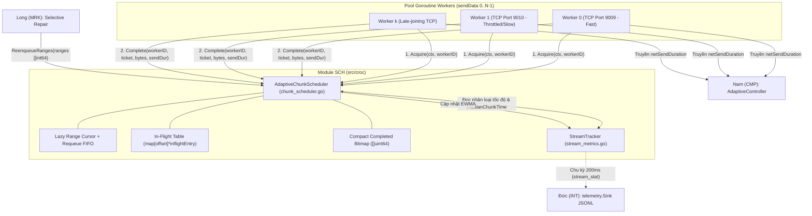
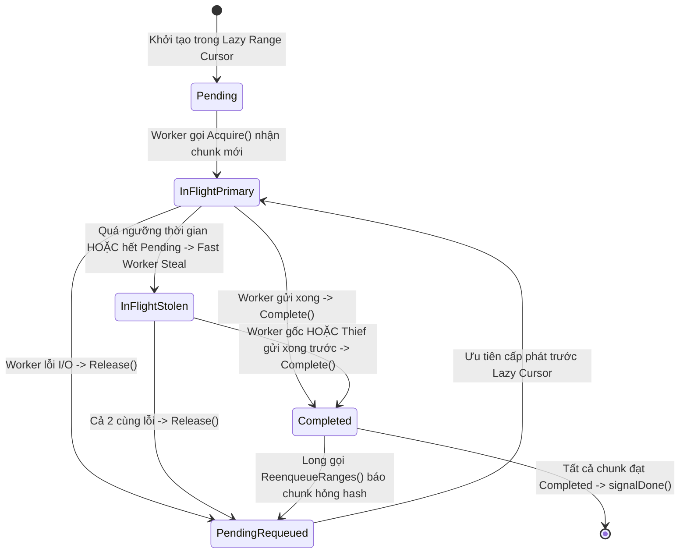

# Kế hoạch Chi tiết `SCH-01` — Thiết kế Kiến trúc Dynamic Scheduler & Work-Stealing

> **Người thực hiện:** **Sơn** (`SCH` — Transport & Scheduling Engineer)  
> **Thuộc lộ trình:** Ngày 1 · [02_Son_SCH_Dynamic_Scheduling.md](../02_Son_SCH_Dynamic_Scheduling.md)  
> **Nhánh mục tiêu:** `feat/sch-workstealing`  
> **Trạng thái:** Đã cài đặt & pass `go test -race` (`croc-main/src/croc/chunk_scheduler.go`, `chunk_scheduler_test.go`)

---

## 1. Phân tích Hiện trạng Mã nguồn Gốc (`croc-main`)

Trước khi thiết kế bộ lập lịch mới, dưới đây là các ràng buộc kỹ thuật rút ra trực tiếp từ mã nguồn hiện tại:

1. **Cơ chế cấp phát offset hiện tại trong [chunk_queue.go](../../croc-main/src/croc/chunk_queue.go):**
   - `requestedChunkQueue` sinh tuần tự từng offset kích thước **32 KiB** (`models.TCP_BUFFER_SIZE / 2`) từ mảng nén `ranges []int64` có cấu trúc `[chunkSize, startOffset_1, count_1, startOffset_2, count_2, ...]`.
   - **Ràng buộc bộ nhớ cực kỳ quan trọng:** Bài kiểm thử [chunk_queue_test.go](../../croc-main/src/croc/chunk_queue_test.go#L113-L138) (`TestRequestedChunkQueueLargeFileDoesNotListOffsets`) kiểm tra khởi tạo queue cho file **100 GiB** (~3,276,800 chunks). Do đó, bộ lập lịch mới **tuyệt đối không được cấp phát trước slice chứa toàn bộ danh sách offset** khi khởi tạo mà phải giữ nguyên cơ chế **Lazy Range Cursor**.
2. **Cơ chế kết nạp Worker động (`startLateSenderWorker`):**
   - Trong [chunk_queue.go](../../croc-main/src/croc/chunk_queue.go#L120-L140), các kết nối TCP data (`comm.Comm`) có thể tham gia vào giữa phiên truyền với `workerID` tăng dần (`0, 1, 2, ...`). Thiết kế scheduler phải hỗ trợ số lượng worker động, không giả định cố định tổng số worker ngay lúc khởi tạo.
3. **Vòng lặp gửi/nhận dữ liệu trong [croc.go](../../croc-main/src/croc/croc.go#L3746-L4035):**
   - **Phía Sender (`sendData`):** Mỗi worker gọi `queue.claim()`, đọc đĩa bằng `fread.ReadAt(payload[8:], readingPos)`, đóng gói `[8B Offset LE][Payload]`, nén/mã hóa AEAD, gửi qua `dataConn.Send(dataToSend)`, cộng `c.TotalSent` và gọi `queue.complete()`.
   - **Phía Receiver (`receiveData`):** Giải mã/giải nén, đọc `position` 8-byte đầu, ghi song song xuống đĩa bằng `receiveFile.WriteAt(data[8:], positionInt64)` ngoài lock, sau đó khóa `c.receiveMutex` để cộng `c.TotalSent` và `c.TotalChunksTransferred`. Vì `WriteAt` theo đúng `positionInt64` vốn đã an toàn khi ghi đè cùng nội dung, điểm duy nhất cần bảo vệ khi có Work-Stealing gửi trùng chunk là **chống cộng đúp bộ đếm tiến độ** (`TotalSent`, `TotalChunksTransferred`, `addProgress`).
4. **Điều kiện đóng file (`onDone`):**
   - Trong `startSenderUnit`, callback `onDone` thực hiện `file.Close()`. Khi có Work-Stealing (2 worker gửi cùng 1 chunk), `onDone` phải được gọi **đúng 1 lần duy nhất** khi đủ 100% số chunk riêng biệt đã hoàn tất, không bị kích hoạt sớm vì đếm trùng chunk stolen.

---

## 2. Kiến trúc Tổng thể Module `SCH`

Để đảm bảo `SCH-03` (`chunk_scheduler.go`) có thể viết và kiểm thử độc lập 100% bằng mock mà không phụ thuộc vào mạng thực hay `telemetry.Sink` của Đức (`INT-01`), kiến trúc được tách làm **2 thành phần kết nối lỏng qua interface**:



---

## 3. Thiết kế State Machine của từng Chunk

Mỗi chunk (xác định bởi `offset` hoặc chỉ số `chunkIdx = offset / chunkSize`) đi qua máy trạng thái sau:



### Quy tắc bất biến (Invariants) của State Machine
1. **Không bao giờ mất chunk:** Một chunk đang `InFlight` nếu gặp lỗi đọc/gửi (`Release`) khi chưa `Completed` bắt buộc phải đẩy vào hàng đợi ưu tiên `requeued` để worker khác lấy ngay.
2. **Giới hạn nhân bản Work-Stealing (`maxConcurrentOwners = 2`):** Mỗi chunk tại một thời điểm chỉ có tối đa **1 Primary Worker** và **1 Stealer Worker** để tránh bão băng thông khi cuối file có nhiều luồng cùng rảnh.
3. **Đếm hoàn tất Idempotent (Chống kích hoạt sớm `onDone`):**
   - Nếu cả Primary Worker và Stealer Worker đều gửi thành công cùng một `offset`, lần `Complete()` thứ nhất chuyển trạng thái sang `Completed` và tăng `completedChunks++`; lần `Complete()` thứ hai thấy bit hoàn tất đã bật thì chỉ ghi nhận thống kê tốc độ cho worker chứ **không tăng** `completedChunks` và **không cộng đúp** tiến độ Sender.
4. **Hỗ trợ sửa lỗi chọn lọc (`ReenqueueRanges`):**
   - Nếu chunk tại `offset` đã `Completed` nhưng phía Receiver phát hiện lỗi hash Merkle và gọi `ReenqueueRanges`, scheduler xóa cờ hoàn tất của `offset` đó, giảm `completedChunks--` (hoặc tăng biến đếm mục tiêu của đợt repair) và đẩy `offset` vào `requeued`.

---

## 4. Đặc tả Cấu trúc Dữ liệu & Bộ nhớ (Tối ưu cho File Lớn)

Để vượt qua bài test file **100 GiB** với chi phí bộ nhớ tối thiểu và tốc độ `O(1)`:

### 4.1. Nguồn phát Chunk chưa gửi (`Pending`)
- **`ranges []int64`, `next int`, `step int64`:** Giữ nguyên con trỏ sinh lười (lazy cursor) như `requestedChunkQueue` hiện tại → tốn **0 byte** cấp phát thêm theo kích thước file lúc khởi tạo.
- **`requeued []int64` (Ring buffer / Slice FIFO):** Chứa các offset bị trả lại do lỗi socket (`Release`) hoặc do `ReenqueueRanges` của Long. Khi cấp chunk mới, **luôn rút từ `requeued` trước**, hết mới rút từ `ranges` cursor.

### 4.2. Bảng theo dõi Chunk đang bay (`inFlight`)
Vì tại mọi thời điểm chỉ có `W` goroutine worker đang chạy (thường `W = 4..8`), bảng `inFlight` chỉ chứa tối đa `W` phần tử:

```go
type inflightEntry struct {
	offset       int64
	primaryID    int
	primaryStart time.Time
	stolen       bool
	stealerID    int
	stealStart   time.Time
	activeCount  int // số worker đang giữ chunk này (1 hoặc 2)
}
```
- Kích thước `map[int64]*inflightEntry` luôn `<= số lượng worker`, việc quét tìm ứng viên để `Steal` chỉ duyệt tối đa 4–8 phần tử (**< 200 ns**).

### 4.3. Tập đánh dấu Chunk đã Hoàn tất (`completedSet`)
- Với file thông thường (`<= 16 GiB`, tức `<= 524,288` chunks 32 KiB): dùng mảng bitset phẳng `[]uint64` cấp phát lười theo trang (paged bitset, mỗi trang 4 KiB quản lý được 32,768 chunks ≈ 1 GiB file).
  - File 800 MB (25,600 chunks) chỉ tốn **3.2 KiB RAM**!
  - File 100 GiB lúc mới khởi tạo (`BenchmarkRequestedChunkQueueNew`) tốn **0 byte** cho các trang chưa chạm tới.

---

## 5. Đặc tả Interface `ChunkScheduler` & Hằng số Điều khiển

### 5.1. Interface phân tách với `StreamTracker` (`SCH-02`)

```go
// WorkerTier phân loại tốc độ tương đối của một kết nối TCP trong pool.
type WorkerTier uint8

const (
	WorkerNormal WorkerTier = iota // Mặc định khi mới khởi động (warm-up)
	WorkerFast                     // Thông lượng >= 0.85 * median và ổn định
	WorkerSlow                     // Thông lượng < 0.35 * median hoặc latency cao đột biến
)

// StreamSpeedInspector cho phép ChunkScheduler truy vấn tốc độ mà không phụ thuộc cứng vào Telemetry.
type StreamSpeedInspector interface {
	ClassifyWorker(workerID int) WorkerTier
	MedianChunkDuration() time.Duration
	RecordSendSample(workerID int, bytes int, sendDur time.Duration)
	RecordSteal(thiefWorkerID int)
}
```

### 5.2. Interface chính `ChunkScheduler` (`SCH-01` → `SCH-04`)

```go
// ChunkTicket đại diện cho quyền xử lý 1 chunk được cấp cho worker.
type ChunkTicket struct {
	Offset   int64
	IsStolen bool
}

// ChunkScheduler thống nhất hành vi giữa bộ lập lịch tĩnh (--sched static)
// và bộ lập lịch động có work-stealing (--sched dynamic).
type ChunkScheduler interface {
	// Acquire lấy chunk tiếp theo cho workerID.
	// Hàm tự xử lý pacing/cooldown cho luồng Slow hoặc chờ ngắn tới thời điểm
	// có thể Steal ở cuối file; trả về ok=false khi toàn bộ phiên gửi đã hoàn tất
	// hoặc ctx bị hủy.
	Acquire(ctx context.Context, workerID int) (ticket ChunkTicket, ok bool)

	// Complete báo cáo workerID đã gửi xong chunk của ticket qua socket.
	// Trả về firstCompletion=true nếu đây là worker đầu tiên hoàn tất offset này
	// (dùng để cộng c.TotalSent và thanh progress đúng 1 lần).
	Complete(workerID int, ticket ChunkTicket, bytesSent int, sendDur time.Duration) (firstCompletion bool)

	// Release trả lại quyền gửi chunk khi worker gặp lỗi đọc đĩa hoặc đứt kết nối
	// trước khi gửi xong.
	Release(workerID int, ticket ChunkTicket)

	// ReenqueueRanges đẩy danh sách chunk hỏng (định dạng ChunkRanges chuẩn croc:
	// [chunkSize, start1, count1, ...]) quay lại hàng đợi để truyền lại chọn lọc (MRK-05).
	// Trả về số lượng chunk thực tế được xếp lịch lại.
	ReenqueueRanges(ranges []int64) int

	// Stats trả về thông số tức thời phục vụ kiểm thử và xuất Telemetry JSONL.
	Stats() SchedulerStats
}

type SchedulerStats struct {
	TotalChunks     int
	CompletedChunks int
	InFlightChunks  int
	StolenChunks    uint64
	RequeuedChunks  uint64
}
```

---

## 6. Thuật toán Lập lịch Động & Work-Stealing Chi tiết

### 6.1. Giai đoạn Khởi động (Warm-up)
- Trong **4 chunks đầu tiên** của mỗi worker, chưa có đủ mẫu EWMA đáng tin cậy → mọi worker đều được coi là `WorkerNormal`, nhận chunk ngay lập tức không áp dụng cooldown hay steal sớm.

### 6.2. Chiến lược Giảm tải Luồng Chậm (Slow-Stream Pacing & Tail Protection)
Khi tổng số worker đang hoạt động `>= 2` và có ít nhất 1 worker không phải `WorkerSlow`:
1. **Tail Protection (Bảo vệ đoạn đuôi file):** Khi số lượng chunk `Pending` còn lại ít hơn `2 * activeWorkers`, **từ chối cấp chunk `Pending` mới cho `WorkerSlow`** để dành trọn các chunk cuối cho luồng nhanh, triệt tiêu tận gốc hiện tượng cả phiên phải đứng đợi luồng chậm ở 99%.
2. **Adaptive Pacing (Giữa file):** Khi còn nhiều chunk `Pending`, `WorkerSlow` nhận một khoảng nghỉ ngắn `cooldown = clamp(medianChunkDur/2, 5ms, 25ms)` thực hiện bằng `time.NewTimer` kết hợp `select` với `ctx.Done()` **bên ngoài mutex** trước khi nhận chunk mới. Nhờ vậy luồng chậm vẫn đóng góp băng thông vừa sức mà không ôm hàng đợi kernel socket quá sâu.

### 6.3. Chiến lược Work-Stealing (Cướp việc Dự phòng)
Một worker gọi `Acquire(ctx, workerID)` sẽ kiểm tra cơ hội **Steal** theo thứ tự ưu tiên:

1. **Điều kiện đủ tư cách Stealer:** `ClassifyWorker(workerID) != WorkerSlow` (luồng đang bị nghẽn tuyệt đối không đi steal việc của luồng khác).
2. **Khi nào kích hoạt Steal?**
   - **Trường hợp A (Giữa phiên — Straggler cực đoan):** Dù vẫn còn `Pending`, nếu tồn tại một `inflightEntry` chưa bị steal (`!entry.stolen`) có thời gian bay `elapsed = now.Sub(entry.primaryStart)` vượt ngưỡng:
     $$\text{elapsed} > \max(3 \times \text{medianChunkDur},\ 50\text{ ms})$$
     thì cấp quyền steal ngay cho `WorkerFast` để giải phóng điểm nghẽn sớm.
   - **Trường hợp B (Cuối phiên — Endgame Mode):** Khi `Pending` đã cạn hoàn toàn (`requeued` rỗng và `ranges` cursor đã hết) nhưng `completedChunks < totalChunks`:
     - Tìm `inflightEntry` chưa bị steal có `elapsed` lớn nhất và thỏa mãn `elapsed >= max(1.5 * medianChunkDur, 15ms)` (hoặc `primaryID` đang bị phân loại `WorkerSlow` thì steal ngay lập tức không cần chờ ngưỡng!).
     - Nếu tất cả `inflightEntry` đều mới bắt đầu gửi chưa đủ ngưỡng hoặc đã có stealer, worker nhanh **không thoát hàm ngay** (vì thoát sớm sẽ đóng goroutine làm mất cơ hội steal nếu luồng kia kẹt sau đó!), mà chờ trên channel thông báo hoặc timer ngắn (`minTimeUntilStealEligible`) cho đến khi: (a) đủ điều kiện steal, (b) có chunk mới từ `ReenqueueRanges`, hoặc (c) `completedChunks == totalChunks` (`allDoneCh` đóng).

---

## 7. Thiết kế Đồng bộ hóa & Đảm bảo Không Deadlock / Race

| Quy tắc An toàn Đồng thời | Cách thực thi cụ thể trong code |
| :--- | :--- |
| **1. Không giữ Lock khi I/O hoặc Sleep** | `q.mu` chỉ khóa các thao tác RAM (`requeued`, `ranges`, `inFlight`, `completedSet`). Mọi lệnh `fread.ReadAt`, `dataConn.Send`, timer cooldown, và callback `onDone()` đều bắt buộc nằm **ngoài** cặp `q.mu.Lock() / Unlock()`. |
| **2. Tránh Busy-Wait ở cuối file** | Dùng `wakeupCh chan struct{}` (buffered size 1, broadcast bằng thay channel mới dưới `q.mu` hoặc `sync.Cond` đi kèm watcher `ctx`) kết hợp `time.NewTimer` tới hạn steal tiếp theo. Không dùng vòng lặp `for` rỗng gây 100% CPU. |
| **3. Thứ tự khóa (Lock Ordering) một chiều** | Nếu `ChunkScheduler` gọi sang `StreamSpeedInspector`, chỉ gọi `ClassifyWorker` / `MedianChunkDuration` (chỉ đọc atomic hoặc lock lá của `StreamTracker`), còn `StreamTracker` **không bao giờ** gọi ngược vào `ChunkScheduler` → đồ thị khóa là DAG không chu trình, **không thể xảy ra Deadlock**. |
| **4. Xử lý an toàn `onDone` với `ReenqueueRanges`** | Trong lượt truyền thường, `onDone` đóng file khi `completedChunks == totalChunks`. Khi tích hợp với `MRK-05` của Long ở `SCH-04`, nếu feature `merkle-chunk-resume-v1` được bật trên phiên hiện tại, việc đóng `senderDataFile` sẽ trì hoãn cho đến khi Receiver gửi `TypeCloseSender` (tức sau khi kiểm tra Merkle hoàn tất, không còn `TypeChunkRepairRequest`), đảm bảo `ReenqueueRanges` luôn đọc lại được từ `fread` hợp lệ. |

---

## 8. Bảng Chốt Giao ước (Shared Contracts) với Team

| Đối tác | Điểm chạm kỹ thuật | Chữ ký / Quy ước đã chốt |
| :--- | :--- | :--- |
| **Đức (`INT-01`)** | PAKE Feature & CLI Flags | • Feature flag: `"dynamic-chunk-sched-v1"`<br>• CLI: `--sched dynamic\|static` (mặc định `dynamic` khi cả 2 peer hỗ trợ), `--debug-throttle-worker <id:rate>`<br>• JSONL event `stream_stat`: `{"ts", "event":"stream_stat", "worker_id", "local_port", "throughput_bps", "inflight", "stolen_chunks"}` |
| **Nam (`CMP-03`, `CMP-04`)** | Báo thời gian gửi mạng tại `sendData` | Đo `t0 := time.Now(); err = dataConn.Send(dataToSend); sendDur := time.Since(t0)` → truyền `sendDur` cho cả `scheduler.Complete(...)` của Sơn lẫn `AdaptiveController.ObserveSend(sendDur)` của Nam. |
| **Long (`MRK-04`, `MRK-05`)** | Truyền lại chọn lọc & Idempotent Receive | • Phía Sender: `ReenqueueRanges(ranges []int64) int` nhận đúng format `CurrentFileChunkRanges` (`[chunkSize, offset1, count1, ...]`).<br>• Phía Receiver (`receiveData`): Bitmap `receivedChunks` chỉ chốt chunk đã nhận sau khi `VerifyChunk` của Long trả về hợp lệ; nếu chunk bị đánh dấu corrupt, gọi `UnmarkReceived(offset)` để lần nhận bù tiếp theo được ghi nhận đầy đủ. |

---

## 9. Checklist Nghiệm thu `SCH-01` (Definition of Done)

- [x] Phân tích đầy đủ giới hạn của `requestedChunkQueue`, `startLateSenderWorker`, `sendData` và `receiveData` trong mã nguồn `croc-main`.
- [x] Thiết kế cấu trúc dữ liệu không liệt kê trước toàn bộ offset (đảm bảo pass benchmark khởi tạo file **100 GiB**).
- [x] Hoàn thiện State Machine xử lý trọn vẹn các trạng thái `Pending`, `InFlightPrimary`, `InFlightStolen`, `Completed`, `PendingRequeued`.
- [x] Chốt chữ ký `ChunkScheduler` tách rời khỏi mạng thực và `telemetry.Sink` qua `StreamSpeedInspector` để code và test độc lập ngay `SCH-03`.
- [x] Xác định rõ cơ chế chống cộng đúp tiến độ (Sender `firstCompletion` & Receiver idempotent bitmap) và quy tắc khóa một chiều chống Deadlock/Data Race.

---

## 10. Các Edge Cases Bắt buộc Kiểm thử khi chuyển sang `SCH-03`

1. **File rỗng (`0 byte`) và file nhỏ chỉ có 1 chunk (`< 32 KiB`):** `Acquire` trả `ok=false` ngay cho file 0B và kích hoạt `onDone` đúng 1 lần.
2. **File cực lớn (`100 GiB`):** Khởi tạo scheduler trong `< 10 µs`, không cấp phát mảng hàng triệu phần tử.
3. **Resume với `ranges` rời rạc / có count `<= 0`:** Khớp 100% tập offset với `utils.ChunkRangesToChunks(ranges)` giống bài test gốc trong [chunk_queue_test.go](../../croc-main/src/croc/chunk_queue_test.go#L84-L111).
4. **Đua tốc độ giữa Primary và Stealer:** Cả hai hoàn tất cùng lúc từ 2 goroutine → `firstCompletion == true` chỉ trả về cho đúng 1 goroutine, `onDone` chỉ chạy đúng 1 lần, pass `go test -race`.
5. **1 Worker chậm 10× trong pool 4 Workers:** Worker chậm bị giảm tải ở cuối file, các chunk đang kẹt bị 3 worker nhanh steal thành công, tổng thời gian hoàn tất giảm mạnh mà không xảy ra livelock.
6. **Gọi `ReenqueueRanges` sau khi một số chunk đã gửi:** Đúng các offset yêu cầu được phát lại và hoàn tất chuẩn xác.
