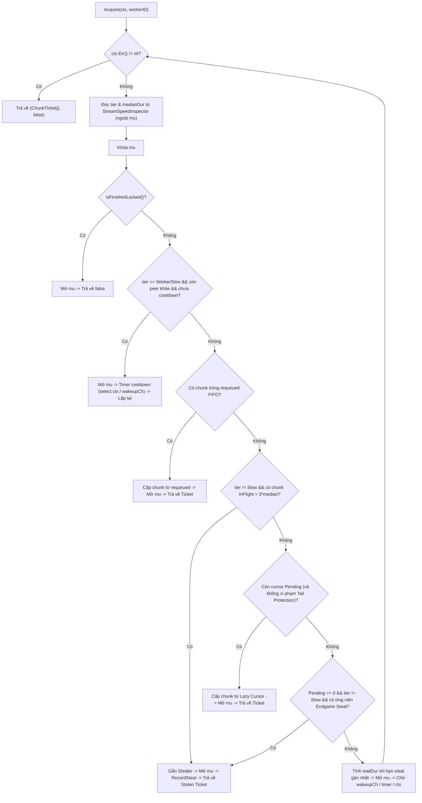

# Kế hoạch Chi tiết `SCH-03` — Cài đặt Hàng đợi Động & Cơ chế Work-Stealing

> **Người thực hiện:** **Sơn** (`SCH` — Transport & Scheduling Engineer)  
> **Thuộc lộ trình:** Ngày 2 · [02_Son_SCH_Dynamic_Scheduling.md](../02_Son_SCH_Dynamic_Scheduling.md)  
> **Kế thừa từ:** [SCH-01_Dynamic_Scheduler_Plan.md](./SCH-01_Dynamic_Scheduler_Plan.md)  
> **Trạng thái:** Đã cài đặt & pass `go test -race` (`croc-main/src/croc/chunk_scheduler.go`, `chunk_scheduler_test.go`)

---

## 1. Mục tiêu & Tiêu chí Hoàn thành (`DoD`)

Từ đặc tả trong [02_Son_SCH_Dynamic_Scheduling.md](../02_Son_SCH_Dynamic_Scheduling.md#L93-L96):
1. Luồng `Fast` (và `Normal`) nhận chunk liên tục không trễ.
2. Luồng `Slow` chịu **pacing/cooldown** giảm tải và bị chặn lấy các chunk cuối file (**Tail Protection**) khi vẫn còn ít nhất một luồng khỏe mạnh đang hoạt động.
3. Khi hàng đợi `Pending` cạn **hoặc** một chunk `InFlight` vượt ngưỡng `elapsed > 3 * median_chunk_time`, luồng khỏe mạnh được phép **steal** chunk đó để gửi song song mà không đóng socket cũ.
4. **DoD kiểm chứng:** Unit test `chunk_scheduler_test.go` với 4 worker (trong đó 1 worker chậm 10×): tổng thời gian hoàn thành giảm rõ rệt so với `staticChunkScheduler`, mọi chunk hoàn tất chính xác 100%, không deadlock, không livelock, pass `go test -race`.

---

## 2. Thiết kế Chi tiết `adaptiveChunkScheduler`

### 2.1. Cấu hình Điều phối (`AdaptiveSchedulerConfig`)

| Tham số | Giá trị mặc định | Ý nghĩa kỹ thuật |
| :--- | :---: | :--- |
| `MidStealMultiplier` | `3.0` | Ngưỡng steal giữa phiên: `elapsed > 3 * medianChunkDur`. |
| `MinMidStealThreshold` | `2 ms` | Ngưỡng sàn chống steal nhầm khi mạng loopback cực nhanh (`< 0.5 ms`/chunk). |
| `EndgameStealMultiplier` | `1.5` | Ngưỡng steal cuối phiên (`Pending == 0`) đối với chunk của luồng bình thường. |
| `MinEndgameStealThreshold` | `1 ms` | Sàn thời gian chờ ở cuối phiên trước khi nhân bản chunk của luồng nhanh. |
| `SlowMinCooldown` | `2 ms` | Thời gian nghỉ tối thiểu mỗi lượt của luồng `Slow`. |
| `SlowMaxCooldown` | `25 ms` | Thời gian nghỉ tối đa mỗi lượt của luồng `Slow` (`clamp(median/2, min, max)`). |
| `TailProtectionFactor` | `2` | Khi `Pending <= 2 * activeHealthyWorkers`, không cấp chunk mới cho `WorkerSlow`. |
| `WorkerActiveWindow` | `2 s` | Cửa sổ xác định một worker khác vẫn đang sống và khỏe mạnh để tránh livelock. |

### 2.2. Thứ tự Ưu tiên trong `Acquire(ctx, workerID)`

### 2.3. Quy tắc Chọn Nạn nhân khi `Steal` (Victim Selection)
Duyệt qua bảng `s.inFlight` (kích thước tối đa chỉ bằng số worker đang chạy, thường 4–8 phần tử):
1. Bỏ qua các chunk đã có stealer (`!entry.canBeStolenBy(workerID)`).
2. Kiểm tra điều kiện đủ ngưỡng thời gian:
   - **Mid-transfer (`pendingCount > 0`):** `elapsed > max(3 * medianDur, MinMidStealThreshold)`.
   - **Endgame (`pendingCount == 0`):**
     - Nếu `ClassifyWorker(entry.primaryWorkerID) == WorkerSlow`: **đủ điều kiện steal ngay lập tức (`0 ms` trễ)** để giải cứu chunk cuối khỏi luồng nghẽn.
     - Ngược lại (primary là luồng khỏe): chờ `elapsed >= max(1.5 * medianDur, MinEndgameStealThreshold)` để tránh gửi lặp vô ích trên các luồng tốc độ ngang nhau.
3. Trong các ứng viên hợp lệ, ưu tiên:
   - Ứng viên đang bị giữ bởi `WorkerSlow` trước;
   - Cùng nhóm tốc độ thì chọn chunk có `elapsed` lớn nhất (và `offset` nhỏ nhất nếu bằng nhau).

### 2.4. Cơ chế Chống Livelock khi Tồn tại Luồng `Slow`
- Mọi cơ chế hạn chế `WorkerSlow` (**Cooldown**, **Tail Protection**, **Cấm Steal**) chỉ kích hoạt khi `hasHealthyPeerLocked(workerID, now) == true` (có ít nhất 1 worker khác thuộc nhóm `Fast`/`Normal` còn hoạt động gần đây).
- Nếu tất cả các luồng nhanh bị đứt kết nối giữa chừng hoặc toàn bộ mạng đều chậm như nhau, `hasHealthyPeerLocked` trả về `false` → luồng `Slow` lập tức được gỡ bỏ hạn chế để tự hoàn tất 100% số chunk còn lại, không bao giờ kẹt ở cuối file.

---

## 3. Kế hoạch Kiểm thử (`chunk_scheduler_test.go`)

1. **`TestAdaptiveChunkScheduler4WorkersWith1Slow10x` (Bài test DoD chính):**
   - Cấu hình 120 chunks, 4 goroutine workers: 3 worker nhanh (`1.5 ms`/chunk) và 1 worker chậm gấp 10× (`15 ms`/chunk, tương đương tốc độ suy giảm 90%).
   - So sánh trực tiếp thời gian chạy thực tế với `staticChunkScheduler` trên cùng cấu hình worker:
     - Ở `staticChunkScheduler`, mỗi lần worker chậm nhặt chunk ở gần cuối file, cả phiên bị kéo đuôi thêm `15 ms`.
     - Ở `adaptiveChunkScheduler`, worker chậm bị cooldown + chặn ở đuôi file và chunk bị ngâm quá `3 * median` được 3 worker nhanh steal xử lý dứt điểm → tổng thời gian giảm mạnh (> 35–50%), `StolenChunks > 0`, mọi offset được hoàn tất đúng, `onDone` gọi đúng 1 lần.
2. **`TestAdaptiveChunkSchedulerMidTransferSteal3xMedian`:**
   - Giả lập 1 worker kẹt cứng giữa phiên trong khi `Pending` vẫn còn chunk → xác nhận worker nhanh chủ động steal ngay khi `elapsed > 3 * median` mà không cần chờ hết `Pending`.
3. **`TestAdaptiveChunkSchedulerDualCompleteIdempotent`:**
   - Cả Primary và Stealer cùng gọi `Complete` song song trên các chunk bị steal → `firstCompletion` chỉ trả về `true` đúng 1 lần cho mỗi offset, `CompletedChunks == TotalChunks`.
4. **`TestAdaptiveChunkSchedulerFallbackWhenOnlySlowWorkerRemains`:**
   - 3 worker nhanh thoát giữa chừng (giả lập rớt socket), chỉ còn 1 worker `Slow` sống sót → xác nhận không bị kẹt bởi Tail Protection và hoàn tất 100% file.
5. **`TestAdaptiveChunkSchedulerRaceStress`:**
   - Chạy đồng thời 8 workers với lỗi `Release` ngẫu nhiên + gọi `ReenqueueRanges` liên tục dưới cờ `-race`.
